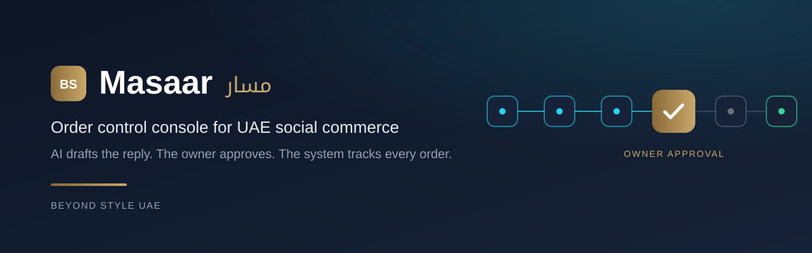
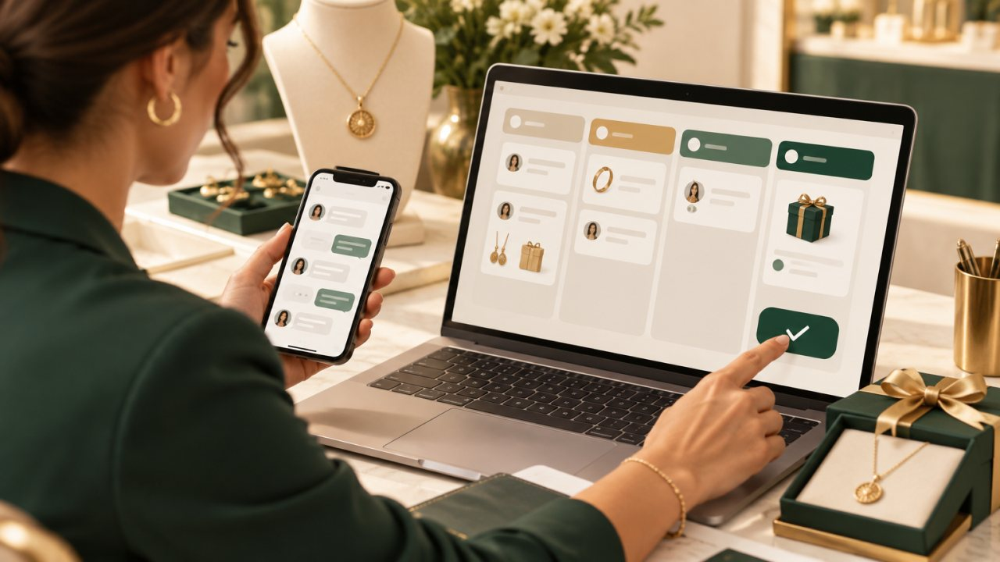
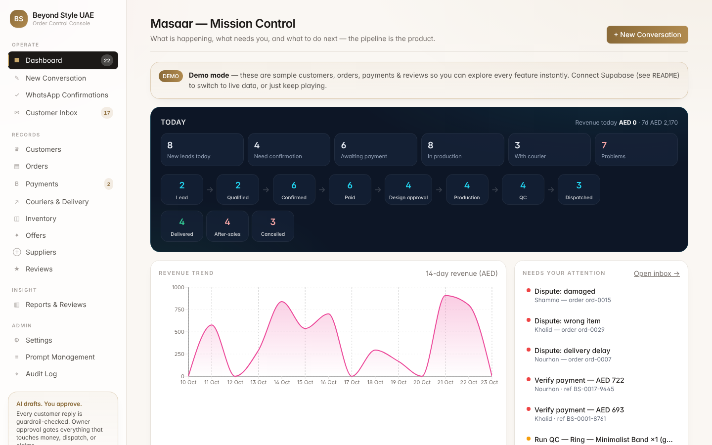
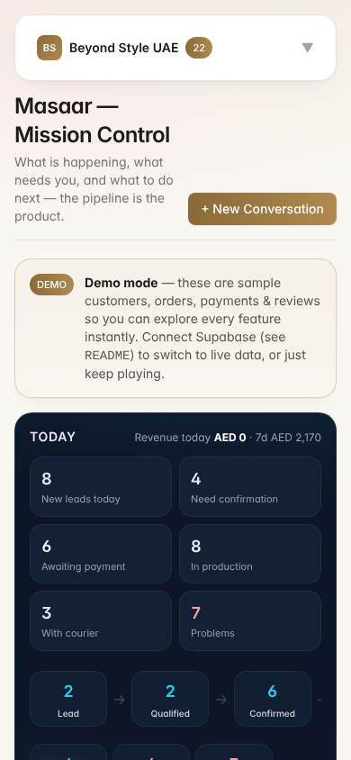
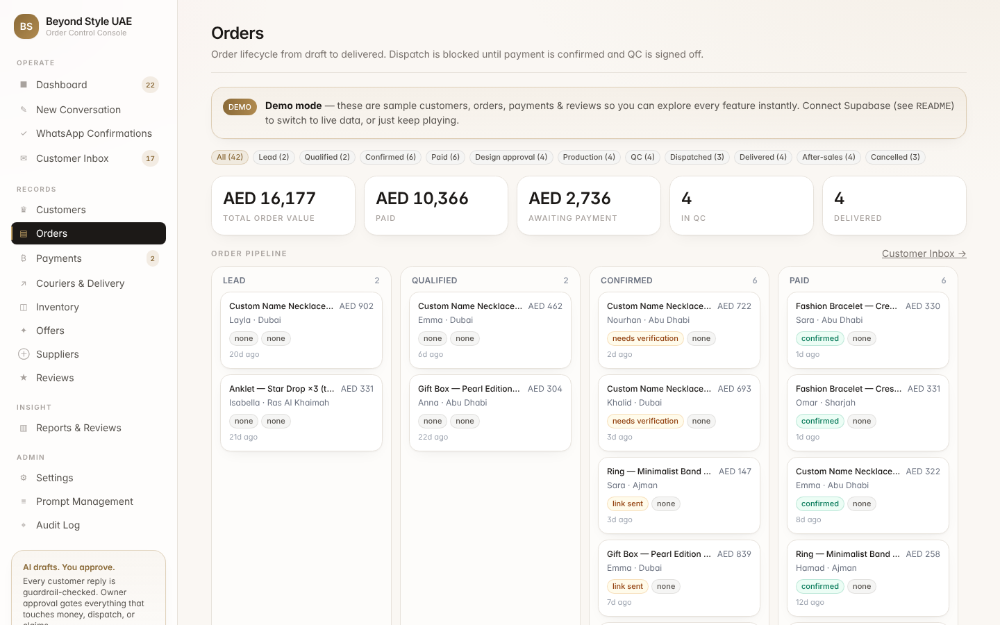
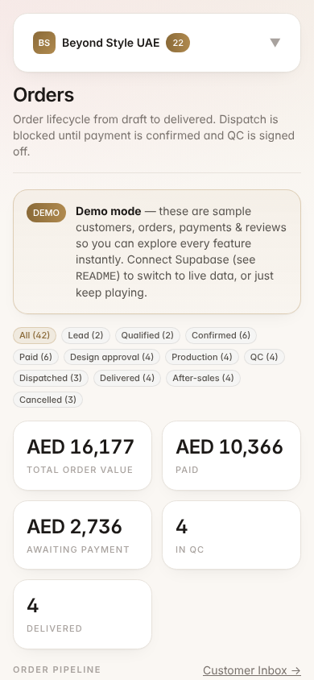
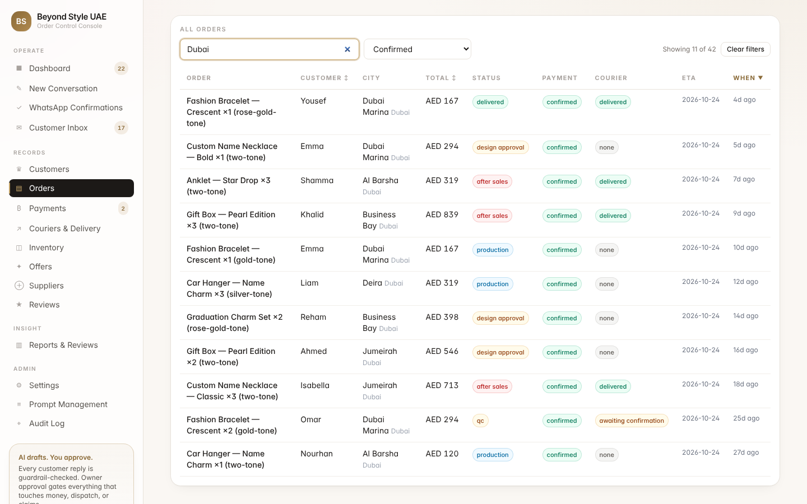
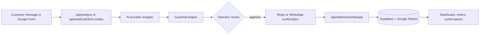

<p align="center">
  
</p>

<p align="center"><br><sub><em>Concept image (AI-generated). Not a product screenshot.</em></sub></p>

<p align="center"><strong>A human-approved sales and order control console for Beyond Style UAE. The agent drafts, the owner approves, the system tracks.</strong></p>

<p align="center">
  
  
  
  
  
  
</p>

## Overview

Masaar is the order control console for **Beyond Style UAE** (BEYOND CONNECT GENERAL TRADING L.L.C.). It is **not** an auto-reply bot. It is a control tower for UAE social commerce. The agent drafts replies and order actions. The owner approves. The system tracks every order from first message to after-sales. Automation comes later, only after the system proves it does not make pricing, delivery, stock or privacy mistakes.

Every drafted customer reply passes through a deterministic **guardrail engine** before an operator can approve it. Automating too early scales mistakes. This console scales discipline instead.

| | |
|---|---|
| **Primary user** | Beyond Style owner and operators |
| **Job to be done** | Move every order from first contact to delivered, and know which orders are stuck and whose move it is |
| **System of record** | Customer, order, payment and fulfilment lifecycle, plus the append-only audit log |
| **System of intelligence** | Pipeline state, guardrails and margin-aware offer suggestions |
| **Explicit non-goals** | Product design, market and portfolio strategy, owning deterministic commerce rules |

See [`docs/PRODUCT_AUTHORITY.md`](docs/PRODUCT_AUTHORITY.md) for the full product authority.

## Key features

- **Mission Control dashboard** (`/`). Today band, interactive order pipeline, revenue trend, attention queue, status and funnel charts, top products and lead sources.
- **Orders** (`/orders`). Stage filter, KPI strip, kanban board and an "All orders" table with live search (product, customer, city, area), payment status filter and sortable columns.
- **Intake and AI analysis** (`/intake`). Paste a customer message and known facts, optionally a screenshot. `POST /api/analyze` returns a structured analysis plus guardrail findings. The operator reviews, copies the reply and approves.
- **Guardrail engine** (`src/lib/guardrails.ts`). Blocks unsupported material claims, privacy leaks, unverified stock or price, unsafe delivery promises and dispatch before payment.
- **Form intake and WhatsApp confirmation gate**. A Google Form submission is validated, then held until the customer confirms on WhatsApp.
- **Live confirmations queue** (`/confirmations`). Polls every 5 seconds, with resend capped at 3 attempts.
- **Durable persistence** to Supabase `intake_orders` and an optional Google Sheets mirror.
- **Configurable AI provider**: `groq`, `together`, `openai`, `openai_compatible`, `anthropic`, `gemini` or `mock`. No keys in code.
- **Demo mode**. With no Supabase env, every page renders a labelled in-memory sample dataset, so the console works on first run.
- **Auth gate** (`src/middleware.ts`). When Supabase is configured, pages require a session and API routes return 401, except `/login` and the external webhooks.

## Screenshots

All screenshots show the built-in **demo dataset** (sample data, not real customers).

| Desktop (1440 x 900) | Mobile (390 x 844) |
|---|---|
|  |  |
|  |  |

Orders table with search and payment filter applied:



## Quick start

Requirements: Node.js 20 or later.

```bash
npm ci
cp .env.example .env.local   # optional: Supabase and AI provider settings
npm test                     # guardrail, intake, confirmation, pricing and pipeline suites
npm run dev                  # http://localhost:3000
```

The app runs before Supabase is configured (demo mode) and before an AI key is set (`AI_PROVIDER=mock` returns placeholder analysis).

### Database

In the Supabase SQL editor or CLI, run the migrations in `supabase/migrations/` in order (`0001` to `0006`), then `supabase/seed.sql` for the default catalogue, offers, couriers, prompts, settings and test-scenario conversations.

## Scripts

| Command | Purpose |
|---|---|
| `npm run dev` | Start the development server |
| `npm run build` | Production build |
| `npm start` | Serve the production build |
| `npm run lint` | ESLint (`next lint`) |
| `npm run typecheck` | TypeScript check (`tsc --noEmit`) |
| `npm test` | Vitest suite (79 tests) |

## Project structure

```
src/
  app/              App Router pages and API routes
    api/            analyze, confirmations, orders/[id]/status, webhook/{form-intake,whatsapp}
  components/       Nav, CommandPalette, charts, ui primitives, orders/*
  lib/
    guardrails.ts   control tower checks (pure, tested)
    ai/             provider wrapper, prompts, analysis pipeline
    intake/ confirm/ notify/ orders/ sheets/   intake, confirmation gate, messaging, persistence
    demo/seed.ts    in-memory demo dataset
  middleware.ts     auth gate
supabase/           SQL migrations and seed
tests/              Vitest suites
python-agent/       standalone LangGraph order pipeline (Python)
landing/            static bilingual landing page (no build step)
scripts/            Google Form Apps Script
docs/               product authority, agent spec, audit baseline, assets
```

## Architecture



- Guardrails are pure functions with no I/O, so they are deterministic and unit tested.
- The provider wrapper returns plain strings. `analyze.ts` extracts JSON and validates it with Zod.
- Every server page degrades to demo data without Supabase, and messaging falls back to a logged mock without provider keys.

### Form intake and WhatsApp confirmation

1. `POST /api/webhook/form-intake` checks the optional `x-webhook-secret`, validates the UAE mobile (normalised to `+9715XXXXXXXX`), emirate and address.
2. A valid lead opens an `order_confirmations` record and sends a WhatsApp message with Confirm, Edit and Cancel buttons. An invalid lead gets a correction request (HTTP 422).
3. `GET /api/webhook/whatsapp` handles the Meta verification handshake. `POST` verifies `X-Hub-Signature-256`, matches the reply (button or free text such as نعم, YES, لا, تعديل) and updates the order. Confirm releases the order to preparation.
4. Inbound events are de-duplicated by Meta message id. Awaiting confirmations older than `CONFIRMATION_TTL_HOURS` (default 24) expire on read.

`scripts/google-form-apps-script.gs` posts each form submission to the webhook.

### Guardrails

| Guard | Rule |
|---|---|
| Claim | Blocks "real gold", waterproof, anti-tarnish and similar claims without supplier evidence |
| Privacy | Detects phone, address or payment data leaking into a reply |
| Price | Requires an active, unexpired offer before quoting |
| Stock | Blocks unverified in-stock promises |
| Delivery | Blocks same-day outside Dubai without courier confirmation |
| Payment | No courier dispatch until payment is confirmed |
| VAT | Flags a missing VAT line when applicable |
| Arabic name | Never blind-transliterates; falls back to أستاذة or أستاذ |

## Deploy on Vercel

`vercel.json` is already in the repository.

| Setting | Value |
|---|---|
| Framework preset | Next.js |
| Root directory | `.` (repository root) |
| Install command | `npm ci` |
| Build command | `npm run build` |
| Output directory | `.next` |
| Region | `fra1` (set in `vercel.json`) |

**Environment variables.** None are required for the build. Without Supabase variables the deployment runs in public demo mode with sample data. For a live deployment set the variables from [`.env.example`](.env.example):

| Variable | Purpose |
|---|---|
| `NEXT_PUBLIC_SUPABASE_URL`, `NEXT_PUBLIC_SUPABASE_ANON_KEY` | Supabase client. Setting these also turns on the login gate |
| `SUPABASE_SERVICE_ROLE_KEY` | Server-side privileged writes |
| `AI_PROVIDER` and the matching key and model (`GROQ_*`, `TOGETHER_*`, `OPENAI_*`, `OPENAI_COMPATIBLE_*`, `ANTHROPIC_*`, `GEMINI_*`) | AI analysis. Defaults to `mock` |
| `WEBHOOK_SECRET` | Shared secret for the form-intake webhook and automation calls |
| `WHATSAPP_PROVIDER`, `WHATSAPP_TOKEN`, `WHATSAPP_PHONE_NUMBER_ID`, `WHATSAPP_VERIFY_TOKEN`, `WHATSAPP_APP_SECRET` | WhatsApp send and inbound verification (`meta` or `mock`) |
| `EMAIL_PROVIDER`, `RESEND_API_KEY`, `EMAIL_FROM` | Email thank-you messages (`resend` or `mock`) |
| `GOOGLE_SERVICE_ACCOUNT_JSON`, `GOOGLE_SHEETS_SPREADSHEET_ID`, `GOOGLE_SHEETS_TAB` | Google Sheets mirror |
| `CONFIRMATION_TTL_HOURS`, `CONFIRMATION_MAX_ATTEMPTS` | Confirmation gate lifecycle (defaults 24 and 3) |

The `landing/` folder is a separate static site and can be deployed as its own Vercel project with `landing` as the root directory and no build command.

## Status and known limitations

- MVP stage. Demo mode uses synthetic sample data. Nothing shown in the screenshots is real customer data.
- Most record pages (customers, inventory, offers, suppliers, reviews) are read-only lists. Create and edit forms are not built yet.
- Daily and weekly reviews show the section structure and KPI snapshot. Auto-drafting them is not wired.
- Screenshot upload is sent to the AI for analysis but is not yet stored in Supabase Storage.
- Without `SUPABASE_SERVICE_ROLE_KEY`, confirmation state uses an in-memory fallback that is for development only.
- WhatsApp, email and Sheets integrations default to logged mocks until credentials are set.

See [`ROADMAP.md`](ROADMAP.md) for planned phases and [`DEVELOPER_NOTES.md`](DEVELOPER_NOTES.md) for design decisions.

## الملخص العربي

<div dir="rtl" lang="ar">

**مسار** هو لوحة التحكم في الطلبات لمتجر **Beyond Style UAE** التابع لشركة بيوند كونكت للتجارة العامة ذ.م.م. وهو ليس روبوت رد آلي، بل برج مراقبة للتجارة عبر وسائل التواصل الاجتماعي في دولة الإمارات: يقترح الوكيل الذكي صياغة الردود وإجراءات الطلب، ويعتمدها المالك، ويتتبع النظام كل طلب من أول رسالة حتى خدمة ما بعد البيع.

تمر كل مسودة رد على محرك ضوابط ثابت يمنع الادعاءات غير الموثقة عن المواد، وتسريب البيانات الشخصية، والوعود غير المؤكدة بالسعر أو التوفر أو التوصيل، وشحن الطلب قبل تأكيد الدفع. كما يتضمن النظام بوابة تأكيد عبر واتساب تُبقي الطلب معلقاً حتى يؤكده العميل.

يعمل التطبيق مباشرة بوضع العرض التجريبي ببيانات نموذجية عند عدم ضبط Supabase، ويمكن نشره على Vercel دون أي متغيرات بيئة إلزامية.

</div>

## License and ownership

Owned by Ahmed Zaian for Beyond Style UAE (BEYOND CONNECT GENERAL TRADING L.L.C., Dubai). No license file is included, so no open-source license is granted. All rights reserved.
